

  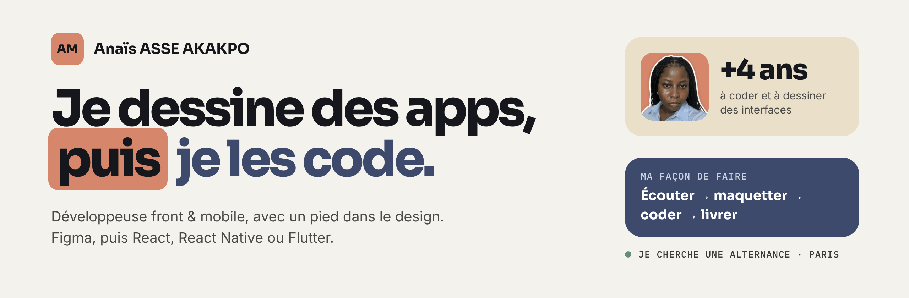

  
  
  
  

## 👋 Moi c'est Anaïs

Je fais la maquette sur Figma, puis l'interface en React, React Native ou Flutter, pour le web comme pour le mobile. Faire les deux m'évite de dessiner des écrans impossibles à coder, ou de coder des écrans que personne n'a envie d'utiliser.

- 🚀 **En ce moment** : co-fondatrice et CTO & UX Lead d'**EventLab**, une billetterie d'événements pour voyageurs
- 🎓 **En parallèle** : Mastère 2 Expert en développement logiciel, mobile et IoT à Ynov Paris
- 🌍 **Parcours** : six missions en quatre ans, à Cotonou d'abord, puis depuis la France

> [!IMPORTANT]
> **Je cherche une alternance en dev front, mobile ou UX**
>
> 📍 Paris · ouverte au remote ou à l'hybride  
> 🗓️ Rythme : 2 semaines en entreprise, 1 semaine à l'école  
> 📧 [anais.asse.akakpo@gmail.com](mailto:anais.asse.akakpo@gmail.com)

## 🧭 Ma façon de faire

**Écouter → maquetter → coder → livrer.** Avant d'ouvrir Figma, je parle aux personnes qui vont utiliser l'app. Je dessine les écrans et je monte un prototype cliquable, on le teste, on corrige, et seulement après, on code.

## ✨ Projets à la une

<table>
<tr>
<td width="50%" valign="top">
<a href="https://github.com/mxdukpe/mise-app">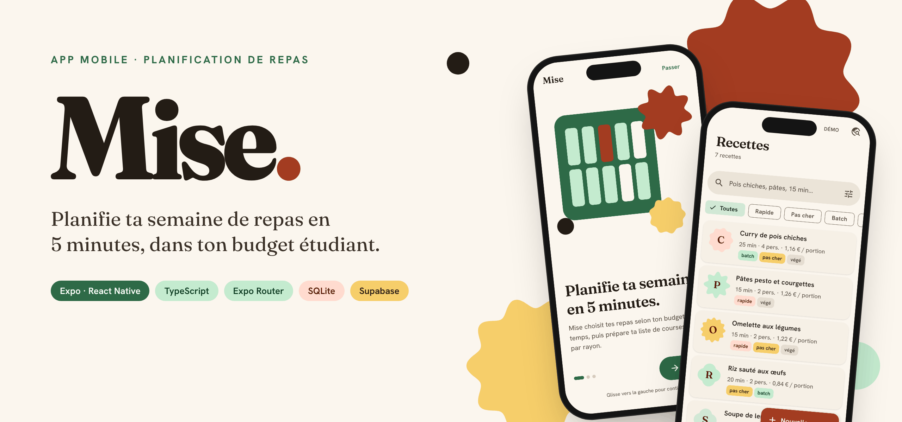</a>
<h3>Mise</h3>
App mobile de planification de repas pour étudiant·e·s : planning de la semaine, liste de courses rangée par rayon, suivi du budget.
  
<b>Maquette + code</b> · Expo, TypeScript, SQLite, Supabase
</td>
<td width="50%" valign="top">
<a href="https://github.com/mxdukpe/kinkynotes">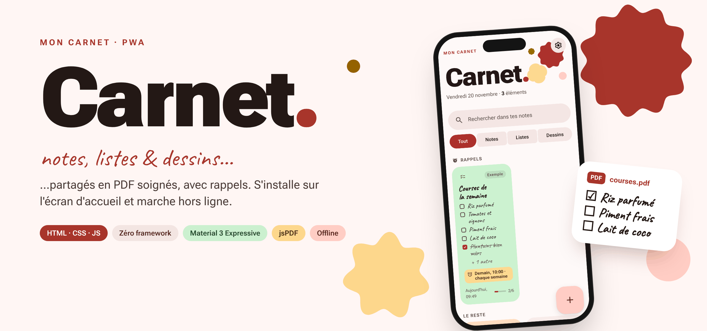</a>
<h3>Carnet</h3>
Notes, listes à cocher et dessins, partagés en PDF soignés, avec rappels. Une PWA qui s'installe sur l'écran d'accueil et marche hors ligne.
  
<b>Maquette + code</b> · HTML, CSS, JS, Material 3 Expressive
</td>
</tr>
<tr>
<td width="50%" valign="top">
<a href="https://github.com/sweethehe/Miwakplon">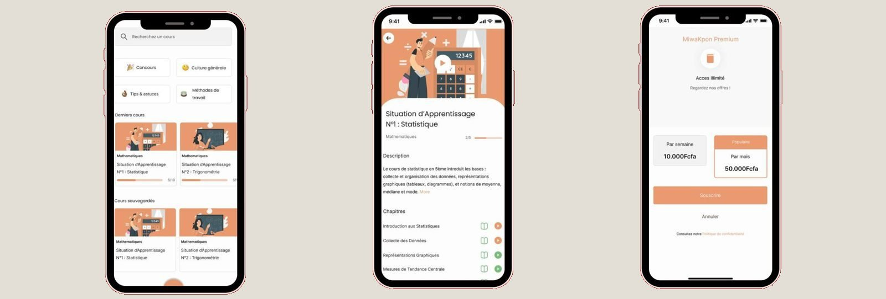</a>
<h3>Miwakplon</h3>
App de tutorat pour les collégiens au Bénin : cours, exercices, quiz et sessions avec des tuteurs, sur abonnement.
  
<b>Maquette + code</b> · Flutter
</td>
<td width="50%" valign="top">
<a href="https://www.figma.com/design/oeHhBYCfEVYLVg0Dz6BgLT/PUSH--N-PULL?node-id=0-1">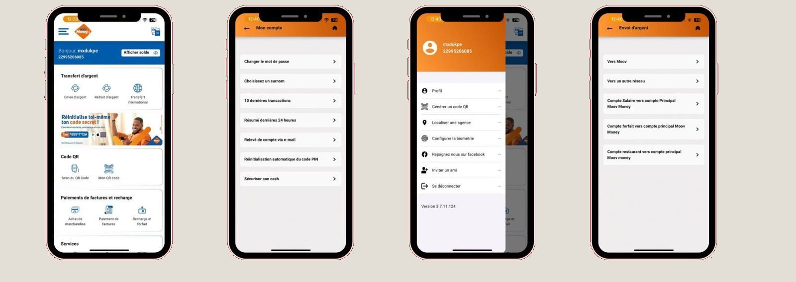</a>
<h3>Moov Money · Moov Africa Bénin</h3>
Nouveaux écrans de l'app de paiement mobile : transfert d'argent, QR code, compte, factures. Recherche utilisateur, maquettes et prototypes.
  
<b>Design</b> · Figma
</td>
</tr>
</table>

## 🗂️ Autres projets

<table>
<tr>
<td width="50%" align="center">
<a href="https://github.com/mxdukpe/glow_diary">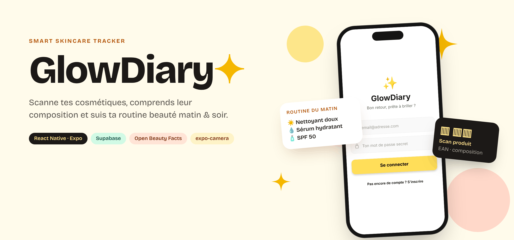</a> 
<b>GlowDiary</b> 
Suivi de routine skincare avec scan de produits · React Native, Supabase
</td>
<td width="50%" align="center">
<a href="https://github.com/mxdukpe/SnapSignal">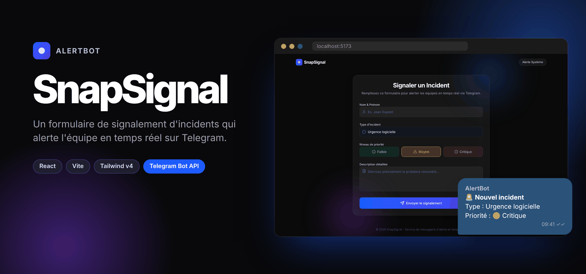</a> 
<b>SnapSignal</b> 
Signalement d'incidents relayé sur Telegram en temps réel · React, Vite, Tailwind
</td>
</tr>
<tr>
<td width="50%" align="center">
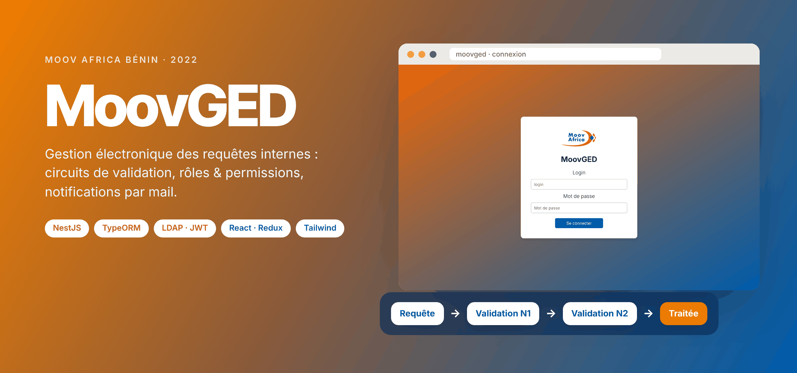 
<b>MoovGED</b> · Moov Africa Bénin 
Plateforme interne de gestion des requêtes, utilisée par les 5 directions · NestJS, React
</td>
<td width="50%" align="center">
<a href="https://github.com/mxdukpe/baraka_tech">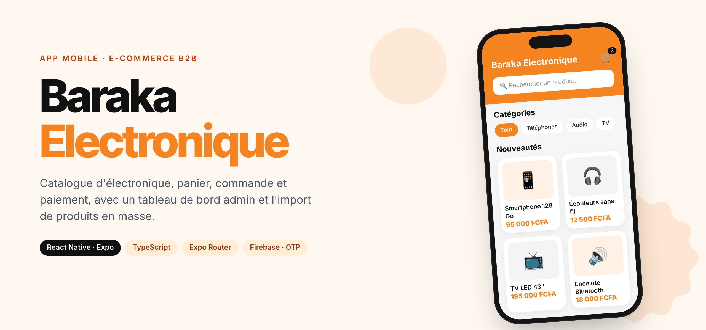</a> 
<b>Baraka</b> 
App e-commerce : catalogue, panier, commande et paiement · React Native
</td>
</tr>
<tr>
<td width="50%" align="center">
<a href="https://github.com/mxdukpe/site_principal_cipajes_html_css_js">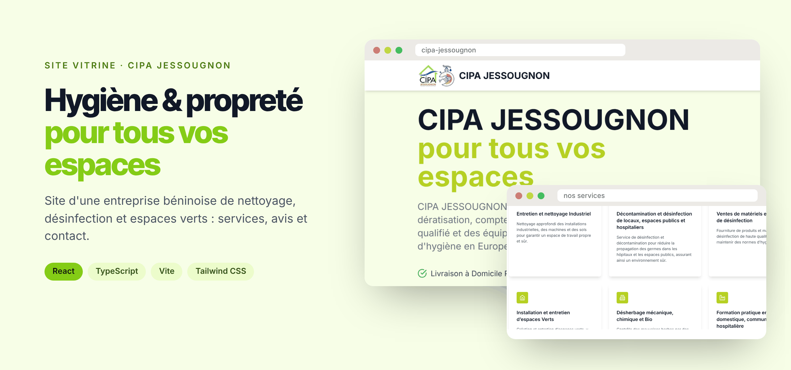</a> 
<b>CIPA JESSOUGNON · Site vitrine</b> 
Site d'une entreprise de nettoyage et d'hygiène · React, TypeScript, Tailwind
</td>
<td width="50%" align="center">
<a href="https://github.com/mxdukpe/Website-E_Commerce-CIPA">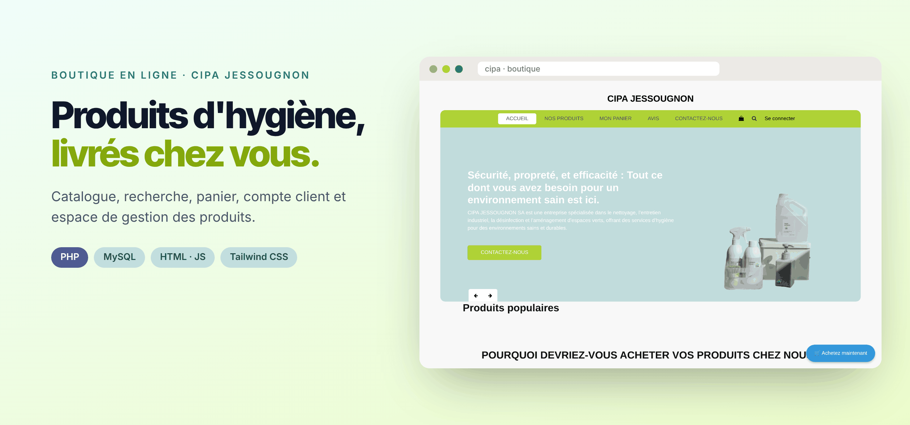</a> 
<b>CIPA JESSOUGNON · Boutique</b> 
E-commerce de produits d'hygiène · PHP, MySQL, Tailwind
</td>
</tr>
<tr>
<td width="50%" align="center">
<a href="https://github.com/mxdukpe/TechCo_Technical_Test">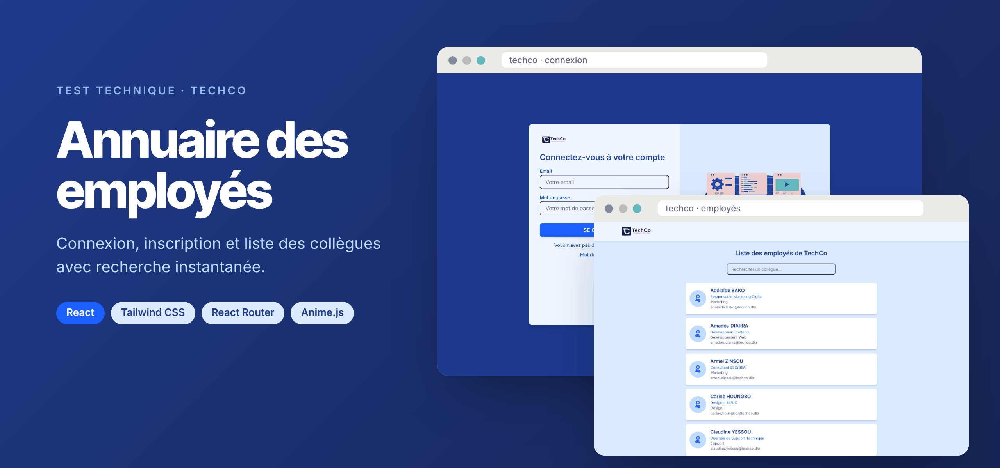</a> 
<b>TechCo</b> 
Annuaire des employés, test technique · React, Tailwind
</td>
<td width="50%" align="center">
<a href="https://github.com/mxdukpe/GearShift-API">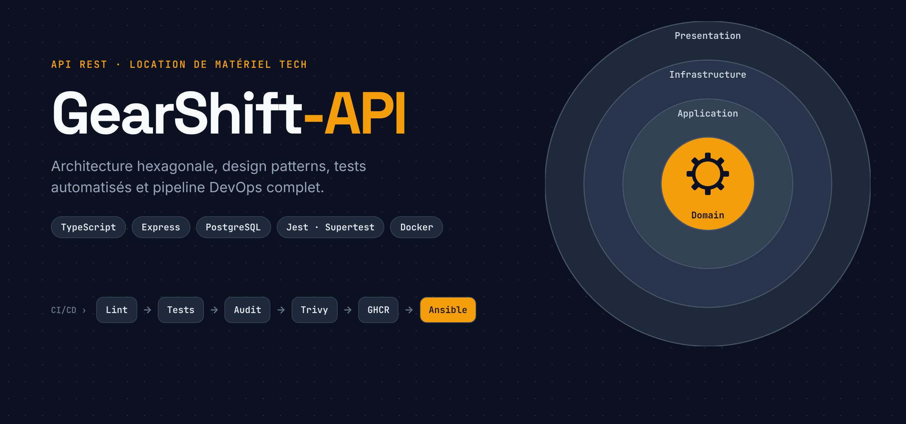</a> 
<b>GearShift-API</b> 
API REST en architecture hexagonale, CI/CD complète · TypeScript, Docker, Ansible
</td>
</tr>
<tr>
<td width="50%" align="center">
<a href="https://github.com/mxdukpe/fullstack-app-prod">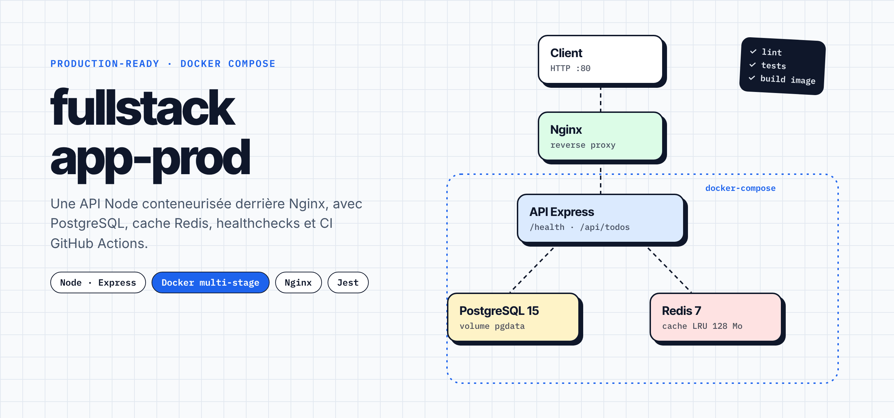</a> 
<b>fullstack-app-prod</b> 
API Node conteneurisée derrière Nginx, avec PostgreSQL et Redis · Docker, GitHub Actions
</td>
<td width="50%" align="center">
<a href="https://mxdukpe.github.io">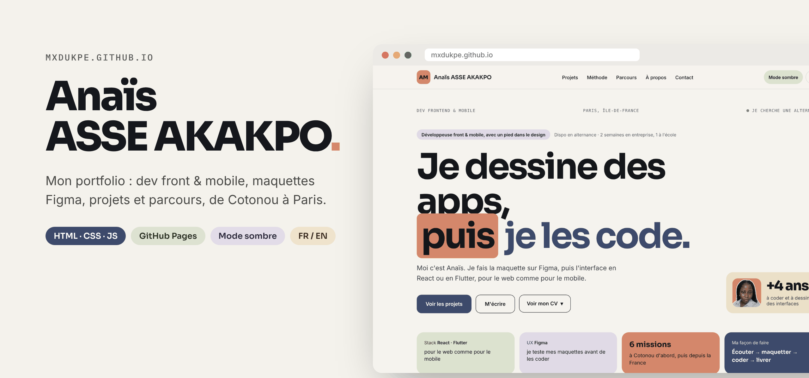</a> 
<b>Mon portfolio</b> 
Le site où je présente mon travail · HTML, CSS, JS
</td>
</tr>
</table>

## 🛠️ Stack

<b>Design</b> 

<b>Web</b> 

<b>Mobile</b> 

<b>Back, données et outils</b> 

## 📍 Parcours

| Quand | Où | Rôle |
|---|---|---|
| Juil. 2026 → aujourd'hui | **EventLab** · Paris | Co-fondatrice, CTO & UX Lead : carte interactive, filtres, géolocalisation, espace Créateur, encadrement d'une dev fullstack |
| Juin → sept. 2026 | **DreamXR** · Cotonou, en remote | Stage dev front : maquette puis site d'une plateforme de réalité augmentée |
| Janv. → oct. 2025 | **Tech&Co** | Lead dev front : architecture React / Tailwind d'un site et de deux apps mobiles, encadrement de 3 devs |
| Oct. → déc. 2024 | **CIPA Jessougnon** | Dev front : boutique en ligne et site vitrine |
| Sept. → déc. 2023 | **Moov Africa Bénin** · Cotonou | Dev front & UX/UI : MoovGED, maquettes et prototypes pour Moov Money |
| Août → déc. 2022 | **Moov Africa Bénin** · Cotonou | Dev web front |

## 🎓 Formation

- **Ynov Paris** · 2025 → 2027, en alternance : Mastère Expert en développement logiciel, mobile et IoT (en M2)
- **Epitech Paris** · 2021 → 2024 : Bachelor en Expertise Informatique
- **Langues** : français (langue maternelle), anglais (B1)

---

  <b>Vous cherchez une alternante en dev front, mobile ou UX ?</b> 
  Écrivez-moi : <a href="mailto:anais.asse.akakpo@gmail.com">anais.asse.akakpo@gmail.com</a> · <a href="https://mxdukpe.github.io">mxdukpe.github.io</a>

